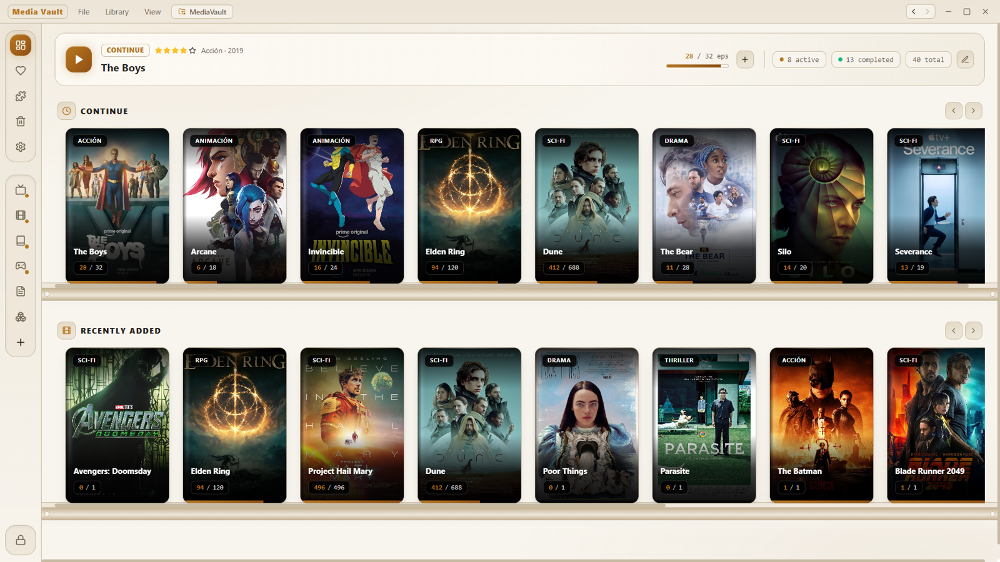
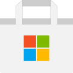
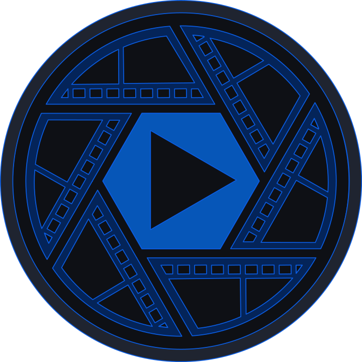
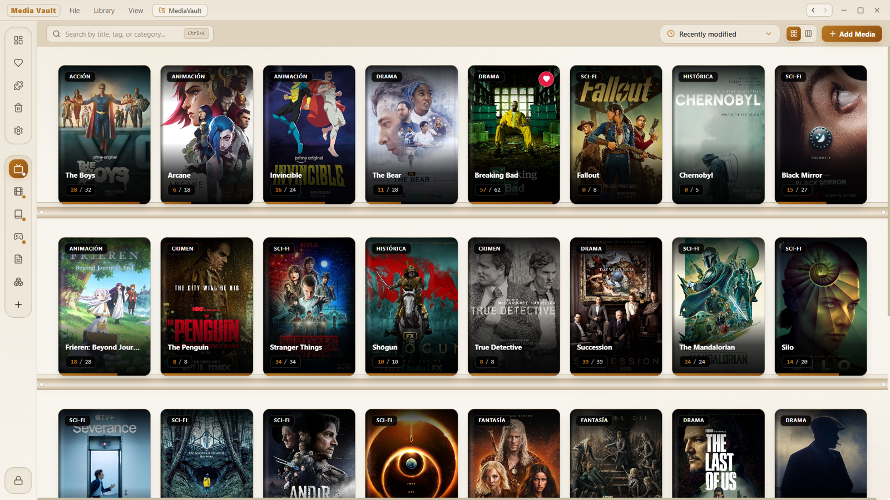
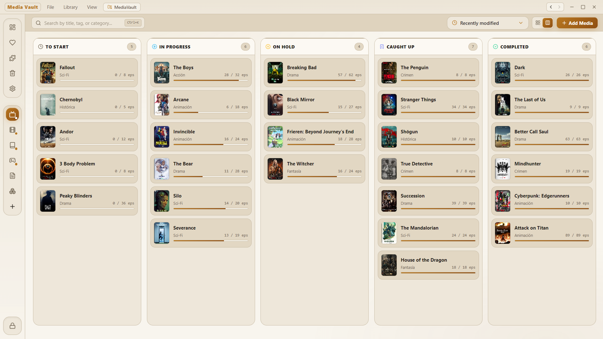
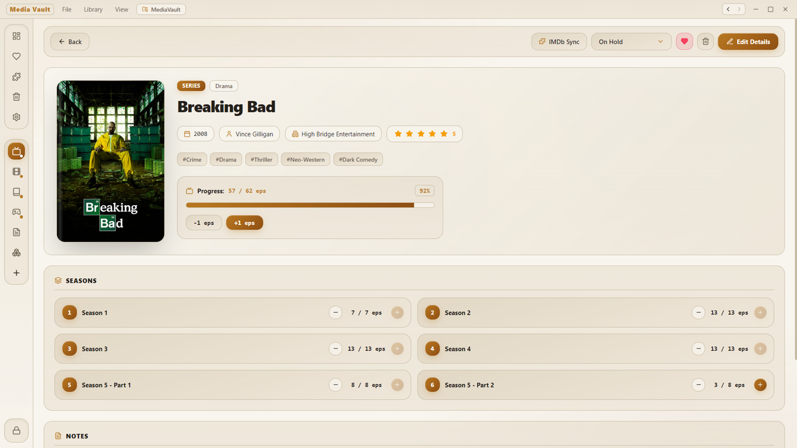
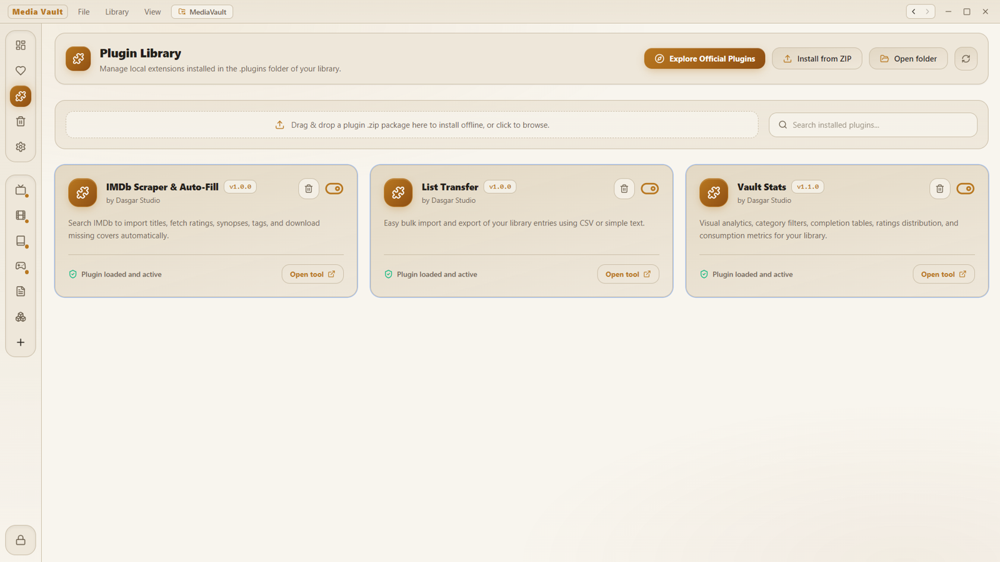
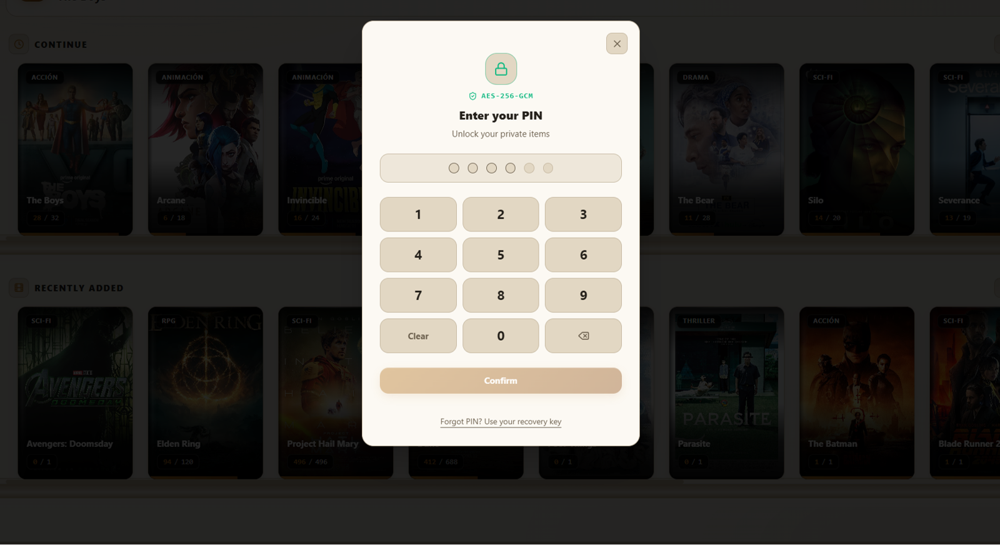
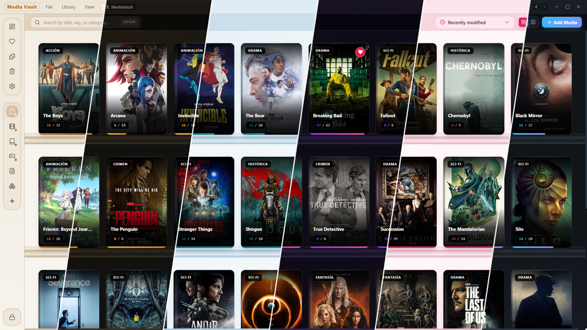
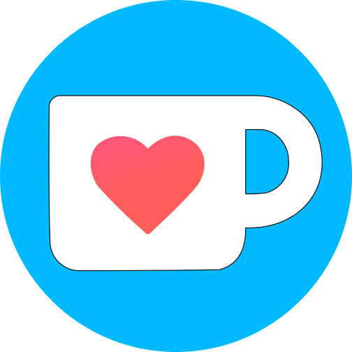

# MediaVault

**MediaVault** is a private, offline-first media tracking and cataloging desktop application built by **Dasgar Studio**. Organize your series, movies, books, games, and notes in plain local files, protect sensitive entries inside an encrypted vault, customize your workspace, and back up your entire library in one click—without accounts or cloud dependencies.

  

---

## Download & Installation

Choose the edition that best fits your setup on **Windows 10 / Windows 11 (64-bit)**:

1.   **MediaVault Atlas — Microsoft Store (Recommended):** Install directly from the Windows Store with automatic background updates managed by Windows Update.
2.   **MediaVault Edge — Windows Installer (`MediaVault Setup 1.0.1.exe`):** Download from **[GitHub Releases](https://github.com/Dasgar-Studio/MediaVault-releases/releases/latest)** for a standard installation with shortcuts and silent background updates.
3.   **MediaVault Edge — Portable Edition (`MediaVault 1.0.1.exe`):** Standalone executable that runs immediately from any folder or USB drive without installation.

---

## Interface & Views

<table>
  <tr>
    <td align="center" width="50%">
      
       
      <strong>Realistic Library Shelves</strong> — Customizable 5-to-10-column shelves with quick progress buttons
    </td>
    <td align="center" width="50%">
      
       
      <strong>Interactive Kanban Board</strong> — Track status columns with automatic completion dates
    </td>
  </tr>
  <tr>
    <td align="center" width="50%">
      
       
      <strong>Detailed Media Sheets</strong> — Multi-season breakdowns, custom fields, and personal notes
    </td>
    <td align="center" width="50%">
      
       
      <strong>Extensible Plugin System</strong> — Offline <code>.zip</code> drag-and-drop and Official Plugin Catalog
    </td>
  </tr>
  <tr>
    <td align="center" width="50%">
      
       
      <strong>Encrypted Private Vault</strong> — PIN-protected space secured with AES-256-GCM encryption
    </td>
    <td align="center" width="50%">
      
       
      <strong>12 Built-In Themes</strong> — 6 Light and 6 Dark presets plus a live custom palette editor
    </td>
  </tr>
</table>

---

## Key Features

### Your Library, Stored Locally in Plain Files
- **Markdown-Native Storage:** Every entry is saved as a clean `.md` file inside organized folders (`Section/Category/Title.md`) that you own forever and can open or edit anywhere.
- **Fast Startup & Live Sync:** Large collections open instantaneously via incremental metadata caching, and any changes made outside the app update automatically in real time.
- **Smart Organization & Duplicate Protection:** Renaming an entry, section, or category automatically updates its folder location, while built-in checks prevent accidentally overwriting existing vaults, sections, or entries.
- **One-Click `.zip` Backups:** Export a full, timestamped backup archive of your library directly from Settings.

### Multiple Ways to Browse & Track
- **Realistic Library Shelves:** Display your covers on customizable 5-to-10-column shelves with per-vault sorting controls, half-star ratings (`0.5`–`5.0`), quick `+1` / `-1` progress buttons, hidden item toggles, and automatic gradient covers when no artwork is provided.
- **Executive Dashboard:** Pick up right where you left off with a quick-resume hero banner, collection statistics, and horizontal carousels for active and recent entries.
- **Drag-and-Drop Kanban Board:** Organize your backlog, in-progress, paused, and completed titles across customizable status columns with collapsible lanes when more than 5 columns exist.
- **Multi-Edit & Bulk Actions:** Toggle **Multi-Edit** directly from the top bar to select multiple entries and batch-update status, category, tags, favorites, hidden visibility, or move items to the recycle bin.
- **Rich Detail Pages:** Track episodes, pages, hours, or simple completed/pending toggles, manage multi-season breakdowns and custom fields with drag-and-drop reordering, and switch status directly from the top bar.
- **Browser-Style History & Safe Links:** Move backward and forward across visited pages (`Alt + ←` / `Alt + →` or mouse side buttons) with unsaved-changes warnings and external link confirmation prompts.
- **Modern Recycle Bin:** Recover accidentally deleted entries with cover previews, search, section filters, and multi-select batch restore.

### Zero-Knowledge Encrypted Private Vault
- **PIN-Protected Private Space:** Keep confidential entries and notes locked behind **AES-256-GCM** encryption.
- **Offline Recovery Key:** Receive a one-time recovery key (`VAULT-XXXX-XXXX-XXXX-XXXX`) during setup—with easy copy and optional `.txt` download—to reset your PIN offline if you ever forget it.
- **Auto-Lock & Panic Shortcut:** Automatically locks and clears private data from memory after 10 minutes of inactivity, or immediately whenever you press `Ctrl + L`.

### Personalization, Languages & Add-Ons
- **12 Built-In Themes & Custom Theme Studio:** Switch effortlessly between 6 Light and 6 Dark palettes or create, edit, and update your own custom themes live.
- **Searchable Section Icons:** Create custom media sections and find the right icon instantly across 150+ categorized icons.
- **Plugins & Extensions:** Extend MediaVault with optional add-ons installed via `.zip` drag-and-drop or the on-demand Official Plugin Catalog.
- **6 Supported Languages:**
  -  English
  -  Español (Spanish)
  -  日本語 (Japanese)
  -  Français (French)
  -  Deutsch (German)
  -  Português (Portuguese)

### Keyboard Shortcuts
- `Ctrl + K`: Open Spotlight Search (`↑`, `↓`, `Enter`, `Esc`).
- `Ctrl + N`: Create a new media entry.
- `Ctrl + L`: Lock or unlock the Private Vault immediately.
- `Alt + ←` / `Alt + →` (or Mouse Side Buttons): Navigate Backward / Forward.
- `Escape`: Clear search or close active dialogs.

---

## Documentation & Guides

- **[Plugin Developer Specification & API Reference (PLUGINS.md)](PLUGINS.md)** — Build custom importers, tools, and metadata scrapers, or browse official extensions at **[MediaVault-plugins](https://github.com/Dasgar-Studio/MediaVault-plugins)**.
- **[Security & Privacy Policy (SECURITY.md)](SECURITY.md)** — Learn how local storage, zero-telemetry guarantees, and AES-256-GCM vault encryption work.
- **[Troubleshooting & Error Handling (TROUBLESHOOTING.md)](TROUBLESHOOTING.md)** — Solutions for file sync, PIN recovery, plugin packages, and updates.
- **[Changelog (CHANGELOG.md)](CHANGELOG.md)** — Version history and release notes.

---

## Support & Contact

- **Bug Reports & Suggestions:** Open an issue on [GitHub Issues](https://github.com/Dasgar-Studio/MediaVault-releases/issues).
- **Direct Support & Security Inquiries:** [dasgarstudio@gmail.com](mailto:dasgarstudio@gmail.com)
- **Support Development:**  [Ko-fi](https://ko-fi.com/dasgarstudio) ·  [GitHub Sponsors](https://github.com/sponsors/Dasgar-Studio)

---

*Copyright © 2026 Dasgar Studio. All rights reserved.*